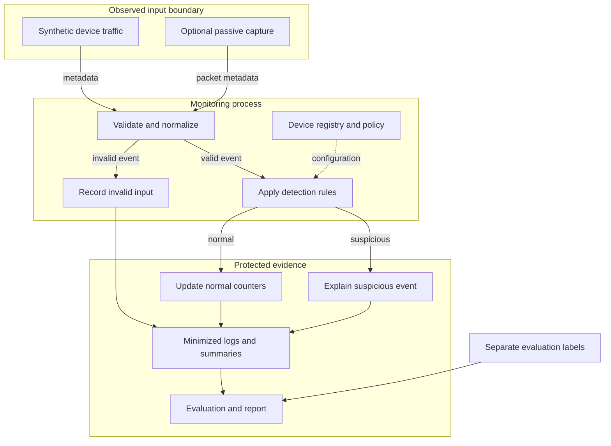

# IoT Security Mini Project Roadmap

This roadmap supports an individual project on **[SELECTED_TOPIC]** using **[CHOSEN_TOOLS]**. It connects the research question, architecture, implementation, security tests, measured results, and institutional report into one reproducible workflow.

The worked example is an **IoT Network Security Monitor**. The previously supplied Python prototype is a functional starting point for synthetic traffic monitoring; its implemented rules flag unknown local IP addresses, traffic bursts, and TCP port-diversity patterns. Device-specific thresholds, additional input validation, privacy-minimized logs, and MQTT integration described below are proposed extensions, not completed features of that starting script.

## Scope and institutional alignment

The available institutional sample, *sample report (1)(1).docx*, specifies 18 report sections and four mandatory tables [R0]. Its administrative instructions refer to a two-student team and a submission date of 18 September 2026. This roadmap follows the current individual-project request. Record the applicable submission date as **[CONFIRMED_SUBMISSION_DATE]**, and obtain the institution's current position on individual submission before filing the final report. This does not prevent development or documentation from proceeding.

The list of 35 approved titles is not available in the materials used for this roadmap. Example specializations below are therefore suggestions within an approved title, not claims about which titles appear in that list. Preserve **[SELECTED_TOPIC]** and **[APPROVED_TITLE_NUMBER]** until the title is verified. The sample uses first-come, first-served allocation and prohibits duplicate project selection; a different subtitle does not establish title availability.

## 1. Project Selection Strategy

### 1.1 Complete a project definition sheet

| Field | Entry |
| --- | --- |
| Approved title and number | [SELECTED_TOPIC]; [APPROVED_TITLE_NUMBER] |
| Application context | [SMART_HOME / LABORATORY / INDUSTRIAL_SENSOR_NETWORK / OTHER] |
| Student details | [STUDENT_NAME]; [UNIQUE_ID]; [YEAR_SEMESTER]; [STREAM] |
| Primary asset | [DEVICE_IDENTITY / SENSOR_DATA / NETWORK_AVAILABILITY / OTHER] |
| Main threat | [THREAT_TO_BE_DETECTED_OR_PREVENTED] |
| Security mechanism | [ANOMALY_DETECTION / AUTHENTICATION / ENCRYPTION / ACCESS_CONTROL / OTHER] |
| Prototype mode | [SIMULATION / PHYSICAL_DEVICES / HYBRID] |
| Tools | [CHOSEN_TOOLS] |
| Original contribution | [SPECIFIC_DESIGN_IMPLEMENTATION_OR_EVALUATION_CONTRIBUTION] |
| Evaluation comparison | [BASELINE] versus [PROPOSED_APPROACH] |
| Completion criterion | [MEASURABLE_ACCEPTANCE_CRITERIA] |
| Available time and deadline | [WORKING_DAYS]; [CONFIRMED_SUBMISSION_DATE] |

### 1.2 Select for feasibility and measurable security

Shortlist three available titles from the official list. Give each criterion a score from 1 to 5, and compute the weighted total as `sum(weight * score / 5)`.

| Criterion | Weight | Question to answer |
| --- | --- | --- |
| Individual feasibility | 30 | Can one student implement, test, document, and explain it within the available time? |
| Measurable security outcome | 25 | Can a controlled test show a correct alert, rejection, protection, or vulnerability finding? |
| Original contribution | 20 | What design choice, implementation, dataset, or experiment will the student create? |
| Evaluation quality | 15 | Is there a fair baseline and a repeatable input set? |
| Resource availability | 10 | Are the required hardware, software, permissions, and data accessible? |

An available approved title, an authorized test environment, and a demonstrable security outcome are prerequisites. A high numerical score does not compensate for their absence.

### 1.3 Define a defensible contribution

An individual project can be original through its implementation and evaluation without inventing a new cryptographic algorithm. Use established libraries for established security mechanisms, cite them, and identify the contribution accurately. Global uniqueness and a particular plagiarism score cannot be guaranteed.

For the monitor example, a suitable specialization is:

**Device-Aware IoT Network Monitoring with Explainable Alerts and Privacy-Minimized Logs**

The research question is: **Can separate traffic thresholds for different device roles reduce false alerts compared with a single network-wide threshold, while preserving detection of the specified suspicious scenarios?**

Keep the contribution manageable:

- Baseline: the supplied monitor with one packet-count threshold for every local source.
- Main extension: thresholds derived separately for a sensor, camera, and gateway using normal calibration traffic.
- Supporting extension: alerts that record the triggering rule, observed value, threshold, and event reference while omitting unnecessary identifiers or payloads.
- Evaluation: compare both approaches using the same held-out labeled scenarios, including legitimate camera bursts and low-rate suspicious activity.

These are proposed contributions. An experiment may show a trade-off or no improvement; report that result honestly.

## 2. System Architecture Design

### 2.1 Define assets, trust boundaries, and flows first

Identify which component produces data, which component can modify it, which component checks it, and where results are stored. For a simulation, labels describing the expected behavior belong in a separate evaluation manifest; the detector must not receive the answer as an input feature.

| Component | Responsibility | Input and output |
| --- | --- | --- |
| Device or traffic simulator | Produce repeatable normal and suspicious records. | Scenario settings -> synthetic records |
| Optional passive capture adapter | Observe an authorized interface. | Observed packets -> metadata records |
| Validator and normalizer | Check timestamps, address syntax, ports, required fields, and supported protocols. | Input records -> valid events or structured rejection records |
| Device registry and policy | Hold approved devices, device roles, windows, and thresholds. | Protected configuration -> detection policy |
| Detection engine | Apply allowlist and behavioral rules. | Event plus policy -> normal or suspicious decision |
| Alert and evidence logger | Record the reason for each decision and relevant run metadata. | Decisions -> JSONL logs and summaries |
| Evaluation module | Compare decisions with separately held labels. | Outputs plus labels -> metrics and comparison tables |

### 2.2 Proposed block diagram



This is the proposed architecture. The full validator, detailed decision log, separate evaluator, and per-device policy require implementation beyond the supplied baseline. A boundary indicates where data must be checked; it does not establish that the network source is authenticated.

### 2.3 Create the final professional diagram

1. Use Mermaid, diagrams.net, PowerPoint shapes, or another vector drawing tool.
2. Show the actual implemented components and label every connection with the data or protocol it carries.
3. Draw visible boundaries around untrusted input, monitoring logic, and protected configuration/evidence.
4. Use solid arrows for runtime data and dashed arrows for configuration, with a legend.
5. Identify the enforcement point for each security claim. For example, topic ACLs belong at an MQTT broker; alert generation belongs at the detector.
6. Distinguish planned extensions from implemented components. Mark optional adapters explicitly.
7. Use readable text, consistent shapes, restrained colors, and arrows that remain understandable in grayscale.
8. Export as SVG or PDF for sharp scaling; add a figure number, caption, and explanation in report Section 6.

The chosen observation point determines network visibility. Gateway capture sees traffic routed through that gateway; communication between devices on the same subnet may require a switch mirror/SPAN port or network TAP. The baseline processes local-source IPv4 traffic and does not establish network-wide visibility.

## 3. Implementation Roadmap

### Step 1 Define the threat model and acceptance criteria

Specify assets, attacker capabilities, assumptions, and exclusions before coding. For the example, an adversarial source may be unknown to the device inventory or an approved source may produce unusual packet patterns. Administrative compromise of the monitoring computer can be recorded as a residual risk outside this prototype's protection.

Define criteria such as:

- Each specified scenario produces the expected rule decision.
- Normal held-out episodes produce a measured false-positive rate below [TARGET_FPR], if attainable.
- Invalid input cannot crash the monitoring loop and produces a structured error.
- Logs contain the required evidence and omit [PROHIBITED_LOG_FIELDS].
- Processing time and memory remain within [MEASURED_RESOURCE_TARGETS].

Targets are requirements to evaluate, not promised results.

### Step 2 Establish the development environment

Use Python 3.10 or later for the supplied prototype, recording the exact installed version. Create a project directory and virtual environment [R1]:

```bash
mkdir iot-security-project
cd iot-security-project
python -m venv .venv
```

Activate it using the command for the actual shell:

| Shell | Command |
| --- | --- |
| Windows Command Prompt | `.venv\Scripts\activate.bat` |
| Windows PowerShell | `.\.venv\Scripts\Activate.ps1` |
| Linux/macOS shell | `source .venv/bin/activate` |

Use `py` or `python3` in place of `python` where appropriate. If activation is unavailable, invoke the virtual environment's Python executable directly.

The baseline simulation needs only the Python standard library. Install optional packages only when the chosen scope requires them:

```bash
python -m pip install scapy
```

Scapy supports the optional packet adapter; operating-system capture permissions and, on Windows, Npcap are separate requirements. For an MQTT extension, install `paho-mqtt` instead of assuming it is part of Python. Node-RED is optional and is not needed to prove the monitoring mechanism.

### Step 3 Organize code and evidence

Create these directories, with portable Python commands if desired:

```bash
python -c "from pathlib import Path; [Path(p).mkdir(exist_ok=True) for p in ('src','config','scenarios','tests','evidence','report')]"
```

| Location | Contents |
| --- | --- |
| `src/` | Simulator, adapters, validator, detector, logger, evaluator |
| `config/` | Example policy, device roles, threshold settings, placeholder configuration |
| `scenarios/` | Synthetic inputs and separate evaluation labels |
| `tests/` | Unit, integration, boundary, negative, and security tests |
| `evidence/` | Run manifests, logs, result tables, terminal captures, environment records |
| `report/` | Diagrams, literature matrix, report draft, references |

Use meaningful version-control commits. Keep virtual environments, passwords, private keys, and sensitive raw captures out of the submitted repository. Store any sensitive local configuration separately from examples.

Record the environment:

```bash
python -c "import json,platform,sys; print(json.dumps({'python':sys.version,'platform':platform.platform()},indent=2))" > evidence/environment.json
python -m pip freeze > requirements-lock.txt
```

An empty package list is valid for a standard-library-only implementation. Record the Python version separately, and add broker or Node-RED versions if those tools are used.

### Step 4 Run the working baseline

Extract the previously supplied `IoT_Network_Security_Monitor.zip`. From its `iot_security_monitor` folder, run:

```bash
python iot_monitor.py --scenario normal --log baseline_normal.jsonl
python iot_monitor.py --scenario mixed --log baseline_mixed.jsonl
python -m unittest -v test_monitor.py
```

With unchanged settings, the normal scenario has 20 synthetic records and no alerts. The mixed scenario has 68 synthetic records and one alert each for `UNKNOWN_IP`, `TRAFFIC_BURST`, and `PORT_SCAN_PATTERN`. The simulation advances virtual timestamps without sending packets. These are baseline demonstration expectations, not results of the proposed extensions.

Use new log filenames for clean runs: the supplied logger appends. Record the code version, command, output file, configuration, and test outcome. Live capture remains a separate environment-dependent test.

### Step 5 Specify and validate input process output data

Use a documented event schema. An example record for a proposed file-replay adapter is:

```json
{
  "event_id": "E0001",
  "elapsed_s": 0.0,
  "src": "192.168.50.10",
  "dst": "192.168.50.20",
  "protocol": "TCP",
  "dport": 8883,
  "initial_syn": false
}
```

The supplied CLI does not accept this JSON directly. Implement a loader that validates it and converts it to the script's `Event` structure. Preserve `event_id` in evaluation records so inputs and outputs can be matched. Require finite nonnegative ordered timestamps, valid IPv4 addresses, defined protocol values, correctly typed flags, and valid port ranges. Decide explicitly how to handle unsupported protocols, zero-valued ports where applicable, duplicate records, and out-of-order data.

| Input | Processing | Output | Evidence |
| --- | --- | --- | --- |
| Authorized sensor events below its threshold | Validate; update source window; apply rules | Normal decision/counter update | Input fixture and normal summary |
| Source missing from inventory | Check local scope and allowlist | `UNKNOWN_IP` alert | Alert linked to input event |
| More than T packets inside W seconds | Expire old timestamps; count current events | `TRAFFIC_BURST` alert | Window, count/threshold bound, event time |
| SYNs to P distinct ports on one destination | Group by source/destination; count ports | `PORT_SCAN_PATTERN` alert | Distinct-port count and threshold |
| Invalid timestamp or malformed address | Validate before detection | Structured rejection; monitoring continues | Rejection record and passing robustness test |

Save ground-truth episode labels separately. Avoid storing passwords, application payloads, or household activity details when packet metadata is sufficient.

### Step 6 Implement one main extension

For the worked example, add a device registry with `[DEVICE_ID]`, role, allowed address, window, and packet threshold. Calibrate thresholds on a reserved normal dataset. One possible transparent policy is:

`T_device = max(T_min, ceil(P99(normal_window_counts)) + margin)`

State how the percentile is computed, the sampling schedule, calibration duration, and selected margin. A small dataset may not estimate the 99th percentile reliably; show a sensitivity analysis or use an explicitly justified simpler policy. Fix thresholds before evaluating the held-out data. Keep packet windows, scan rules, and cooldown settings identical to the baseline when isolating the contribution of device-specific thresholds.

Implement explainable records containing `run_id`, `event_id`, rule, device reference, observed condition, threshold, action, and elapsed time. Use synthetic device labels in demonstrations. If real identifiers must be transformed, a keyed pseudonym scheme and protected mapping can reduce exposure, but the result remains pseudonymized data; timing and correlations can still reveal behavior.

### Step 7 Add MQTT only if required by the selected topic

For an authentication or secure-communication project, install a local Mosquitto broker and a Python MQTT client [R2–R4]:

```bash
python -m pip install paho-mqtt
```

Provision an individual account per simulated device, disable anonymous access, restrict each account to its required topics, and configure TLS. Use a lab-issued server certificate whose subject alternative name matches `[BROKER_HOST]`. Clients must trust the issuing CA and verify the broker hostname; do not disable certificate verification to make a test pass. Validate a connection with the correct CA, and rejection with an untrusted CA.

An illustrative single-computer broker configuration is:

```text
listener 8883 127.0.0.1
allow_anonymous false
password_file [ABSOLUTE_PASSWORD_FILE]
acl_file [ABSOLUTE_ACL_FILE]
certfile [ABSOLUTE_SERVER_CERTIFICATE]
keyfile [ABSOLUTE_SERVER_PRIVATE_KEY]
```

All placeholder files must be created before launch and readable by the broker account. For access from another authorized lab device, replace the loopback bind address with the designated lab interface and apply the lab's access policy. Keep private keys out of published evidence. Mosquitto's configuration and authentication documents define these controls; check the installed version's supported configuration options [R2–R3].

Example topic policy:

```text
user sensor01
topic write lab/sensor01/telemetry

user monitor
topic read lab/+/telemetry
```

Bind account identity to permitted topic names at the broker. A device identifier inside a JSON payload is merely a claim. An ordinary subscriber does not receive the publisher's authenticated username in every message, so identity checks must respect the broker's enforced topic policy. Failed connections and broker-level rejections require broker-log evidence; a subscriber cannot observe messages that the broker never delivers.

Use the installed Paho version's documented client API and network loop. Encryption protects transport, authentication checks credentials, and topic permissions control access; test each claim independently. TLS alone does not reject an application-level replay. Add application-level sequence/nonce verification and persistent replay state only if replay prevention is part of the selected scope, then test duplicate deliveries and restart behavior.

MQTT messages and captured IP packets are different measurement units. A message-based adapter requires its own rate thresholds and cannot be evaluated as if one message always equals one packet.

If Node-RED is used for visualization, treat the dashboard as an interface. Protect the editor/Admin API with `adminAuth`; secure any HTTP endpoints separately [R5]. Export the flow and version information as implementation evidence. Keep the core security decision reproducible without a dashboard.

### Step 8 Evaluate document and rehearse

Run the framework below, populate actual-result fields from recorded execution, and write the discussion after reviewing the data. Preserve failed tests and explanations. Re-run the documented setup in a clean environment before submission, and rehearse the entire pipeline without relying on unexplained code.

### Suggested individual schedule

| Working sessions | Work | Completion evidence |
| --- | --- | --- |
| 1–2 | Verify title; define scope; review related work | Project definition, literature matrix, threat model |
| 3 | Architecture and environment | Diagram, module plan, version records |
| 4–5 | Reproduce baseline; prepare inputs and labels | Runnable baseline, fixtures, baseline logs |
| 6–8 | Implement the selected contribution | Reviewed modules and passing unit/integration checks |
| 9–10 | Security and performance comparison | Raw logs, test table, metrics, failure analysis |
| 11–12 | Complete report and viva demonstration | Fully populated report, clean reproduction, contribution statement |

Adjust this schedule to [AVAILABLE_WORKING_SESSIONS]. If time is limited, keep one security mechanism and evaluate it thoroughly.

## 4. Testing Framework

### 4.1 Use an evidence record for every run

Record `[RUN_ID]`, `[TEST_ID]`, date/time, exact command, code revision, configuration revision, operating system, package versions, input filename/hash, random seed if any, reset conditions, expected outcome, actual outcome, and evidence paths. A checksum ties a result to an input file; it does not establish authorship.

Use statuses `PASS`, `FAIL`, `NOT_RUN`, and `NOT_APPLICABLE_WITH_REASON`. A missing dependency or unavailable capture permission is not a passed test. Include preconditions, numbered reproduction steps, input, processing rule, and expected output in each detailed test case.

### 4.2 Security Testing mandatory table

The first five columns below preserve the sample's required format. Maintain preconditions and evidence references in the detailed test record.

| Test Case | Condition/Attack | Expected Result | Actual Result | Status |
| --- | --- | --- | --- | --- |
| TC01 Normal sensor | Authorized source; normal rate | No suspicious-traffic alert | [OBSERVED_RESULT] | NOT_RUN |
| TC02 Unknown source | Local source absent from inventory | Unknown-source alert with evidence | [OBSERVED_RESULT] | NOT_RUN |
| TC03 Burst | T+1 packets inside W seconds | Burst alert | [OBSERVED_RESULT] | NOT_RUN |
| TC04 Threshold boundary | Exactly T packets inside W seconds | No burst alert for a strict greater-than rule | [OBSERVED_RESULT] | NOT_RUN |
| TC05 Window expiry | Old record exactly W seconds before current event | Old record excluded from `(t-W,t]` | [OBSERVED_RESULT] | NOT_RUN |
| TC06 Distinct ports | P initial SYNs to P ports on the same destination | Port-pattern alert | [OBSERVED_RESULT] | NOT_RUN |
| TC07 Repeated port | Repeated SYNs to one port | No distinct-port alert; rate rule remains independent | [OBSERVED_RESULT] | NOT_RUN |
| TC08 Malformed data | Invalid address, missing field, or nonfinite timestamp | Structured rejection; process remains usable | [OBSERVED_RESULT] | NOT_RUN |
| TC09 Legitimate camera burst | Normal camera activity higher than sensor baseline | Measure false alerts for both approaches | [OBSERVED_RESULT] | NOT_RUN |
| TC10 Low-rate suspicious episode | Suspicious activity below the selected threshold | Record any missed detection as a limitation | [OBSERVED_RESULT] | NOT_RUN |
| TC11 Cooldown | Duplicate trigger during and after cooldown | Suppression and re-alert match documented policy | [OBSERVED_RESULT] | NOT_RUN |
| TC12 Privacy inspection | Examine every submitted log field | No prohibited identifiers, payloads, or secrets | [OBSERVED_RESULT] | NOT_RUN |
| TC13 Invalid credentials, if MQTT | Known lab account with wrong password | Broker denies authentication | [OBSERVED_RESULT] | NOT_RUN |
| TC14 Topic authorization, if MQTT | Valid account publishes to another device's topic | Broker prevents unauthorized delivery | [OBSERVED_RESULT] | NOT_RUN |
| TC15 TLS verification, if MQTT | Client trusts an unrelated CA | Connection fails certificate verification | [OBSERVED_RESULT] | NOT_RUN |

These are planned tests for the selected/proposed project. Reproduce even previously passing baseline scenarios in the final code version; do not transfer earlier pass labels to new behavior automatically. For TC14, verify broker logs and subscriber delivery, not merely that the publisher's send function returned.

### 4.3 Threat and Attack Analysis mandatory table

| Asset | Threat | Vulnerability | Attack | Impact | Countermeasure |
| --- | --- | --- | --- | --- | --- |
| Device inventory | Unrecognized device | Missing admission/inventory checks | Synthetic unknown-source activity | Unobserved participation | Allowlist alert; actual authentication if within scope |
| Service availability | Excessive traffic | No device-specific traffic baseline | Synthetic high-rate episode | Processing or network overload | Burst detection; evaluated rate control only if implemented |
| Device services | Reconnaissance | Unnecessary exposed services | Synthetic multi-port SYN pattern | Discovery of potential entry points | Port-pattern alert; service hardening recommendation |
| Sensor identity | Impersonation | Trusting IP/payload identity alone | Claimed authorized identity | Misattribution | Authenticated broker identity and topic policy if implemented; otherwise residual risk |
| Monitoring policy | Threshold manipulation | Writable configuration | Simulated unauthorized configuration change | Evasion or false alarms | Restrict configuration access; record policy version and changes |

Add likelihood, impact, and residual-risk rationale in the accompanying discussion. If using a 1–5 risk matrix, explain the scale and treat the scores as assessments rather than measured probabilities.

### 4.4 Privacy Threat Analysis mandatory table

| Data/Asset | Privacy Threat | Possible Leakage | Privacy Mechanism | Expected Protection |
| --- | --- | --- | --- | --- |
| Device addresses | Tracking | Identification of household devices | Synthetic IDs; restricted inventory; keyed pseudonyms if needed | Reduced direct identifier exposure |
| Traffic timestamps | Behavioral inference | Occupancy or daily routine | Minimize timestamps in shared reports; restrict detailed evidence | Less exposure of fine-grained behavior |
| Application payload | Sensitive-content disclosure | Sensor values or personal information | Metadata-only processing for monitoring | Avoid unnecessary payload persistence |
| Credentials and keys | Secret disclosure | Logs, screenshots, repository history | Protected secret storage; redaction before submission | Prevent accidental distribution of secrets |
| Evidence archive | Excessive retention | Long-lived behavioral records | [RETENTION_PERIOD], access restrictions, deletion procedure | Limit access duration and retained detail |

Privacy controls do not eliminate every inference risk. Explain any trade-off between evidence detail and minimization, and verify claimed log exclusions using actual output.

### 4.5 Performance Evaluation mandatory table

| Metric | Baseline/Existing | Proposed | Observation |
| --- | --- | --- | --- |
| Precision | [MEASURED_VALUE_OR_NA] | [MEASURED_VALUE_OR_NA] | [INTERPRETATION] |
| Recall | [MEASURED_VALUE_OR_NA] | [MEASURED_VALUE_OR_NA] | [INTERPRETATION] |
| False-positive rate | [MEASURED_VALUE_OR_NA] | [MEASURED_VALUE_OR_NA] | [INTERPRETATION] |
| Median and p95 processing time | [MILLISECONDS_PER_EVENT] | [MILLISECONDS_PER_EVENT] | [TRADE_OFF] |
| Throughput | [EVENTS_PER_SECOND] | [EVENTS_PER_SECOND] | [LOAD_CONDITIONS] |
| Peak memory | [MIB_AND_MEASUREMENT_METHOD] | [MIB_AND_MEASUREMENT_METHOD] | [RESOURCE_COST] |
| Log volume | [BYTES_PER_RUN] | [BYTES_PER_RUN] | [EVIDENCE_PRIVACY_TRADE_OFF] |

Use a defined evaluation unit. For a window-based monitor, labeled episodes are often clearer than labeling every contributing packet. Count an episode as detected if its expected rule appears within a predeclared evaluation interval. Define overlaps and cooldown handling before evaluation; also evaluate individual rules separately where appropriate.

For a binary suspicious-versus-normal task:

- `Precision = TP / (TP + FP)`
- `Recall = TP / (TP + FN)`
- `False-positive rate = FP / (FP + TN)`

Report `N/A` when a denominator is zero. Choose confidence intervals only when the sampling design supports them. Do not infer real-world accuracy from the small built-in demonstration.

For a fair comparison, use identical held-out inputs, seeds, hardware, duration, and logging settings unless logging is itself the evaluated contribution. Reserve calibration data separately and split by independent run/device/scenario where necessary to avoid correlated-window leakage. Reset state between runs, execute at least five paired trials for timing/resource measurements, and record variability and failures. Repeating identical synthetic inputs measures runtime repeatability, not a broader population of attacks.

Use `time.perf_counter()` for elapsed processing time. `tracemalloc` measures Python allocation tracking, not total process RSS; if reporting RSS, use a suitable system/process measurement such as `psutil` and document it. Keep simulation event time, rule-trigger delay, end-to-end latency, and CPU processing time as distinct quantities. A six-port pattern may require several input events before its rule can fire, even when processing is fast.

## 5. Report Structure Compliance

### 5.1 Preliminary pages

Preserve the two title-page positions in the sample unless the institution supplies a revised format. Fill the project title, unique ID, student name, year/semester, stream, course code, course name, academic year, and faculty details. The sample identifies course **CYB23DLU05**, **PRIVACY & SECURITY IN IOT LABORATORY**, academic year **2026–2027**, and **Dr. S. Surya** [R0]; verify changes with the institution before submission.

Retain the bonafide certificate layout and complete only factual student/project information. Leave signatures, examiner approval, and evaluation date for the authorized people. Add a contents page, lists of figures/tables, and abbreviation list if required for the final report. Do not invent certification or institutional endorsement.

### 5.2 Address every required section in the specified order

| No. and required section | Content to write thoroughly | Evidence to include |
| --- | --- | --- |
| 1 Abstract | Summarize the problem, objective, application, mechanism, implementation, evaluation setup, principal measured results, and limitation. Write it after testing; use [MEASURED_RESULT] while drafting. | Values traceable to Results and Analysis |
| 2 Introduction | Separate background, problem statement, motivation, objectives, and scope. Identify who is affected, what visibility/protection is missing, why existing methods are insufficient for the selected context, and what the prototype will demonstrate. | Objectives with measurable acceptance criteria; scope and exclusions |
| 3 Literature Survey | Review at least 10 relevant verified sources as a quality target, or the institutional minimum if different. Compare problem, method, setting/data, security property, evaluation, limitations, and relevance. Distinguish research papers from standards and implementation documentation. | Literature matrix, accurate citations, explicit project gap |
| 4 Existing System | Describe the actual baseline and its operating assumptions. Explain what it does well, its weaknesses, and why it is a fair comparator. For this example, document the fixed-threshold monitor. | Baseline architecture/configuration and reproduced baseline output |
| 5 Proposed System | Explain the contribution, requirements, methodology, design rationale, expected benefit, and possible costs. Separate implemented controls from future work. | Objective-to-module mapping and design decisions |
| 6 CPS/IoT System Architecture | Explain device/perception, communication, processing, and application layers as applicable. Label data paths, trust boundaries, security controls, and physical versus simulated elements. | Block diagram, data flow, deployment diagram, input schema |
| 7 Module Description | For every module, specify purpose, inputs, processing, outputs, interfaces, dependencies, and error behavior. Explain device management, detection, logging, and any authentication or communication modules. | Module table, API/event definitions, relevant pseudocode |
| 8 Threat and Attack Model | Identify assets, adversary capabilities, entry points, assumptions, threats, vulnerabilities, impacts, countermeasures, and residual risk. Explain the limits of the test environment. | Mandatory Threat and Attack Analysis table plus risk rationale |
| 9 Privacy Threat Analysis | Explain what each data field may reveal, where it flows, who can access it, how long it is retained, and how minimization/pseudonymization changes exposure. | Mandatory Privacy Threat Analysis table and field/retention inventory |
| 10 Security and Privacy Mechanism | Specify the selected control precisely: rule equations, window boundaries, thresholds, identity checks, encryption configuration, access policy, or minimization procedure. Cover key/credential management if applicable. | Control-to-threat mapping, configuration, limitations |
| 11 Implementation | Record hardware or simulation substitutes, OS, Python/tool versions, environment setup, source structure, module integration, commands, input/process/output examples, and failure handling. | Reproduction instructions, selected original code excerpts, version and dependency records |
| 12 Security Testing | Describe unit/integration/negative/boundary tests and controlled threat simulations. Record preconditions, steps, expectations, actual output, status, and evidence location. | Mandatory Security Testing table and individual test records |
| 13 Performance Evaluation | State the dataset, calibration/test separation, metrics, units, measurement tools, repetitions, state resets, and hardware. Distinguish synthetic event time from actual processing time. | Mandatory Performance Evaluation table and raw measurements |
| 14 Results and Analysis | Present actual findings with readable tables/plots and genuine execution outputs. Explain false alarms, missed detections, failed tests, unusual observations, and whether each objective was met. | Raw-output references, result tables, figures, uncertainty/limitations |
| 15 Comparative Analysis | Compare baseline and proposal under matched conditions. Discuss detection quality, runtime, memory, complexity, and privacy costs. Include an ablation where useful to isolate one contribution. | Matched comparison table and clearly justified conclusions |
| 16 Conclusion | Answer the research question using the measured evidence. State achieved objectives, practical significance, and main limitation without adding new experimental claims. | Explicit references to evaluated objectives |
| 17 Future Enhancement | Describe realistic extensions arising from observed limitations, such as IPv6, per-role policies, stronger identity, broker integration, capture-health reporting, or additional datasets. | Prioritized future work, clearly separate from implemented features |
| 18 References | Include every cited paper, standard, tool document, reused asset, and external code source in one consistent institutional citation style. Verify authors, titles, dates, and DOI/URLs. | Complete references matching in-text citations |

The sample lists methodology within the required project approach rather than as an independent numbered chapter. Make it explicit in Proposed System, Implementation, Security Testing, and Performance Evaluation. If an added Methodology heading is wanted, use a subsection while preserving the required chapter order.

### 5.3 Objective and problem statement drafting guides

**Objective template:** To design and implement [SECURITY_MECHANISM] for [IOT_APPLICATION], demonstrate its behavior under [CONTROLLED_SCENARIOS], and evaluate [METRICS] against [BASELINE].

**Problem statement template:** In [IOT_ENVIRONMENT], [ASSET] is exposed to [THREAT] because [VULNERABILITY_OR_VISIBILITY_GAP]. Existing [APPROACH] has [SPECIFIC_LIMITATION]. This project investigates whether [PROPOSED_METHOD] can improve [MEASURABLE_PROPERTY] within [RESOURCE_AND_SCOPE_CONSTRAINTS].

**Methodology template:** Identify assets and data; model threats and privacy risks; select the control; implement a reproducible baseline and proposal; prepare separated calibration and test scenarios; conduct controlled security tests; measure performance; compare results; explain residual risks.

### 5.4 Literature and requirements traceability

For each literature source, record `[SOURCE_ID]`, full citation, research question, method, dataset/environment, metric/result, limitation, and how it informs the project. Do not copy numerical results into the project's own Results section. Read original sources before summarizing them, and verify claimed gaps against more than one source where possible.

Maintain a traceability table:

| Objective | Module/control | Test/evidence | Report location |
| --- | --- | --- | --- |
| Detect unknown local sources | Registry and allowlist rule | TC02 and alert log | 7, 10, 12, 14 |
| Compare device-aware rates | Calibration and threshold module | TC03–TC05, TC09–TC10, paired runs | 5, 10, 13, 15 |
| Reduce logged sensitive data | Evidence logger and retention policy | TC12 and field audit | 9–12, 14 |
| Demonstrate secure MQTT, if selected | Broker TLS, accounts, topic ACLs | TC13–TC15 and broker logs | 6–8, 10–14 |

Cover device/sensor management, authentication/access control, threat analysis, privacy analysis, trust/security mechanism, secure communication, detection/prevention, monitoring/logging, and performance evaluation in the relevant chapters. For a component outside the selected implementation scope, provide its analysis, assumptions, and justified limitation; do not claim an unimplemented feature exists. In particular, an IP allowlist is not cryptographic authentication, and passive alerts do not block traffic.

Append source listings, example configuration, scenario manifests, full test records, execution logs, dependency records, and reproduction instructions after the required sections if permitted by the institutional format.

## 6. Academic Integrity Checklist

- [ ] The title is on the approved list, available for allocation, and recorded as [SELECTED_TOPIC].
- [ ] The current individual-submission arrangement and [CONFIRMED_SUBMISSION_DATE] are recorded accurately.
- [ ] A contribution statement separates student-written work, adapted/reused code, external libraries, and AI assistance where disclosure is required.
- [ ] Every borrowed algorithm, code fragment, figure, dataset, and substantial idea has attribution; applicable licenses are retained.
- [ ] Originality is demonstrated through independent design decisions, implementation, reproducible scenarios, and analysis. Renamed files or cosmetic edits are not presented as substantive contributions.
- [ ] Documentation is written from understood sources and actual implementation, with quotations and citations where needed.
- [ ] All claimed features exist in the submitted revision; planned components appear under Future Enhancement or are explicitly labeled proposed.
- [ ] Synthetic records are labeled synthetic, and hardware testing is claimed only when hardware was used.
- [ ] Expected output is separated from actual recorded results. No fabricated screenshots, metrics, approvals, signatures, or literature references are included.
- [ ] Failed tests, false positives, missed detections, and out-of-scope threats are reported.
- [ ] Test labels are kept out of detector inputs; calibration is separated from evaluation; comparisons use matched conditions.
- [ ] Secrets and unnecessary personal data are absent from code, logs, screenshots, and the submitted archive.
- [ ] Every report chapter and all four mandatory tables are complete, with no unexplained blank results.
- [ ] Input/process/output records, commands, configurations, versions, and evidence paths support each result.
- [ ] Another person can reproduce the demonstration from the README and supplied files.
- [ ] The student can explain every module, rule, parameter, metric, security limitation, and external dependency during viva.
- [ ] The final report uses the institution's required citation, formatting, and AI-use policies without asserting unsupported authorship or guaranteed plagiarism scores.

### Final submission package

Submit the completed institutional report, editable architecture diagram, runnable source, dependency/version records, example configuration with placeholders, synthetic inputs with separate labels, automated tests, measured result tables, sanitized evidence, and a short demonstration script. A dashboard or slide deck may support the presentation, but the security mechanism and its evidence should remain understandable independently.

### Reference material used for this roadmap

- **[R0] Institutional source:** *sample report (1)(1).docx*, available sample, pages 1–5; report structure and mandatory tables are on pages 4–5. This source supplies formatting requirements, not results for the selected project.
- **[R1] Python:** [venv documentation](https://docs.python.org/3/library/venv.html).
- **[R2] Eclipse Mosquitto:** [Authentication methods](https://mosquitto.org/documentation/authentication-methods/).
- **[R3] Eclipse Mosquitto:** [Configuration manual](https://mosquitto.org/man/mosquitto-conf-5.html).
- **[R4] Eclipse Paho:** [Python MQTT client documentation](https://eclipse.dev/paho/files/paho.mqtt.python/html/client.html).
- **[R5] Node-RED:** [Securing Node-RED](https://nodered.org/docs/user-guide/runtime/securing-node-red).
- **[R6] Existing project scaffold:** *IoT_Network_Security_Monitor_Guide.md* and *IoT_Network_Security_Monitor.zip*, supplied in this conversation; disclose any reused or adapted scaffold appropriately.

These references support the format and setup guidance. They are not a completed topic-specific literature survey. Technical references checked on 11 October 2026.
